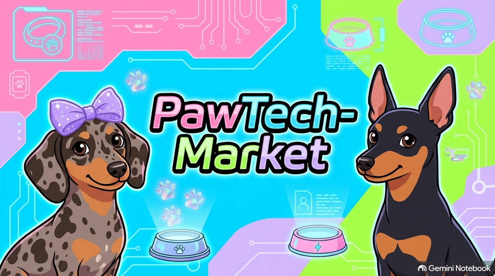

# PawTech-Market



## Objetivo

PawTech-Market es un proyecto de investigación de mercado para productos y
nutrición inteligente para mascotas. El equipo está preparando la estructura
inicial de un sistema multi-agente con CrewAI, LangGraph y MCP. La interfaz de
usuario se desarrollará en una etapa posterior.

> **Estado actual:** repositorio en fase de setup. Las carpetas son espacios de
> trabajo iniciales; los agentes, el grafo, las herramientas, los servidores MCP
> y la UI todavía no están implementados.

## Estructura inicial

```text
agents/       Agentes CrewAI
graph/        Estado y orquestación LangGraph
tools/        Herramientas compartidas y esquemas Pydantic
mcp_servers/  Servidores y clientes MCP
ui/           Interfaz de usuario (desarrollo posterior)
tests/        Pruebas con pytest
assets/       Recursos visuales del proyecto
```

## Equipo y responsabilidades

| Persona | Rol | Responsabilidad inicial |
| --- | --- | --- |
| Vanesa | Persona 1 — Crew Lead IA | Diseñar los agentes, sus tareas y la colaboración con CrewAI. |
| Adri | Persona 2 — LangGraph Lead | Definir el estado compartido y la orquestación del flujo con LangGraph. |
| Luis | Persona 3 — MCP Lead | Diseñar e implementar servidores/clientes MCP y herramientas integradas. |
| Josema | Persona 4 — Frontend Lead | Desarrollar la futura interfaz de usuario y conectarla con el flujo del sistema. |
| Joselillo | Persona 5 — QA & Ops Lead | Preparar el setup, estructura, dependencias, pruebas iniciales y controles de calidad. |

Las responsabilidades concretas y los contratos entre componentes se acordarán
en equipo antes de implementar los flujos de extremo a extremo.

## Alcance del setup inicial

El primer commit de Persona 5 (QA & Ops) prepara únicamente la base compartida:
carpetas rastreables, dependencias iniciales, plantilla de variables de entorno,
reglas de exclusión, README y una prueba de humo. No incluye implementación de
agentes, orquestación, servidores MCP ni interfaz; cada responsable incorporará
esas piezas en los siguientes cambios coordinados.

## Preparar el entorno

Se recomienda Python 3.10 o superior. Desde la raíz del repositorio:

```bash
python -m venv .venv
```

Activa el entorno virtual:

```powershell
# Windows PowerShell
.\.venv\Scripts\Activate.ps1
```

```bash
# macOS / Linux
source .venv/bin/activate
```

Instala las dependencias base:

```bash
python -m pip install --upgrade pip
pip install -r requirements.txt
```

Crea `.env` a partir de `.env.example` y configura las claves que tengas
autorización para usar. Nunca subas `.env` ni credenciales al repositorio.

```powershell
# Windows PowerShell
Copy-Item .env.example .env
```

```bash
# macOS / Linux
cp .env.example .env
```

## Pruebas iniciales

```bash
pytest
```

Las pruebas actuales solo comprueban importaciones de dependencias base y la
presencia de `.env.example`. Se ampliarán al incorporar funcionalidad.

## Flujo Git

- `main`: rama estable; no realizar commits directamente.
- `develop`: integración del trabajo del equipo.
- `feature/<descripcion-corta>`: ramas de trabajo creadas desde `develop`.
- Integrar cambios mediante Pull Requests hacia `develop`, con descripción,
  pruebas relevantes y al menos una revisión de otro integrante.
- Mantener los cambios enfocados y no incluir secretos, entornos virtuales,
  cachés ni datos locales.
