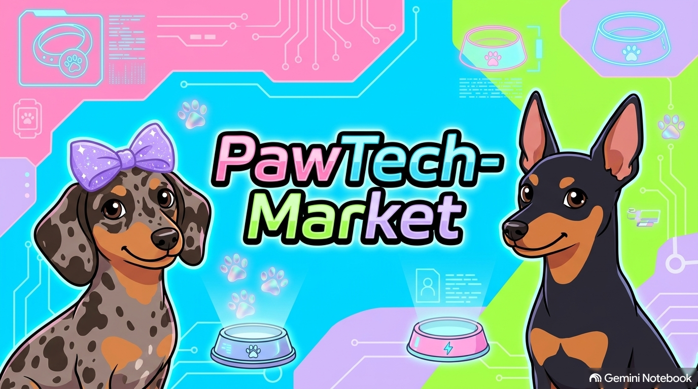

# PawTech-Market



# PawTech-Market


## Descripción

PawTech-Market es un prototipo de investigación de mercado para el sector
de mascotas. Combina cinco agentes especializados definidos con CrewAI,
un flujo de trabajo de tres hitos mediante LangGraph y herramientas de
búsqueda web y análisis cuantitativo.

El sistema recibe un encargo, propone subtareas, permite seleccionar
cuáles ejecutar y prepara resultados que una persona puede revisar antes
de avanzar.

El proyecto se contextualiza en una tienda simulada de productos y
alimentación para mascotas. PawTech-Market actúa como herramienta de
apoyo a la investigación comercial: no constituye por sí mismo una tienda
online ni ejecuta compras o cambios de precios.

## Público objetivo y propuesta de valor

El público objetivo propuesto son empresas que comercializan productos
y alimentación para mascotas, especialmente comercios que necesitan
investigar competidores, referencias y precios.

La propuesta de valor consiste en organizar la recopilación de información,
el análisis numérico y la elaboración de informes en un flujo revisable.

El ahorro de tiempo, la precisión y la disposición de las empresas a pagar
por el servicio están pendientes de validación con usuarios y mediciones.

## Alcance actual

La configuración de agentes y tareas contempla alimentación y gadgets
para mascotas.

Sin embargo, el recorrido cuantitativo actual está especializado en
alimentación:

- Recopila marca, producto, tienda, precio, peso del envase y fuente.
- Calcula el precio por kilogramo cuando dispone de precio y peso.
- Elimina referencias repetidas por marca, producto y tamaño, priorizando
  la oferta con menor precio por kilogramo cuando está disponible.
- Calcula estadísticas sobre los precios por kilogramo identificados.
- Integra los resultados en un informe.

Los dispositivos inteligentes pueden aparecer como hallazgos de
investigación, pero no cuentan con un esquema específico de
características técnicas ni una comparación cuantitativa por precio unitario.

Las estadísticas describen los productos encontrados durante el estudio;
no representan necesariamente todo el mercado.

## Componentes incluidos

- Cinco agentes especializados.
- Orquestación de tres hitos mediante LangGraph.
- Selección humana de subtareas y revisión de resultados.
- Búsqueda web mediante una llamada a la API de Groq.
- Análisis estadístico con pandas y validación con Pydantic.
- Solicitud de análisis cuantitativo mediante un cliente MCP.
- Interfaz Streamlit conectada al servidor por WebSocket.
- Entrada de consultas por texto o grabación de voz.
- Generación de audio a partir de resultados de los hitos.
- Exportación de informes en Markdown y JSON.
- Registro de decisiones humanas y mensajes de actividad.
- Modo simulado para desarrollo y pruebas.

La disponibilidad de los servicios externos depende de la configuración,
las credenciales, las dependencias y los límites del proveedor.

## Arquitectura

```text
Persona usuaria
    |
    +-- Consulta escrita
    |
    +-- Grabación de voz
            |
            v
      Transcripción con faster-whisper
            |
            v
      Revisión del texto
    |
    v
Interfaz Streamlit
    |
    v
Servidor WebSocket
    |
    v
Sesión y grafo LangGraph
    |
    +-- Hito 1: investigación
    |      |
    |      +-- Investigador CrewAI
    |      +-- Herramienta de búsqueda web mediante Groq
    |      +-- Productos, precios y fuentes
    |
    +-- Hito 2: análisis
    |      |
    |      +-- Cliente MCP → servidor y herramienta numérica
    |      +-- Estadísticas con pandas
    |      +-- Interpretación cuantitativa
    |      +-- Observaciones textuales de presentación
    |
    +-- Hito 3: informe
           |
           +-- Redacción estratégica
           +-- Revisión crítica cuando se selecciona
           +-- Revisión humana
           +-- Exportación Markdown y JSON

Resultados de los hitos
    |
    +-- Visualización en la interfaz
    +-- Generación de audio mediante edge-tts, a petición de la persona
```

## Agentes y responsabilidades

| Agente | Responsabilidad |
| --- | --- |
| Investigador de mercado | Proponer subtareas y recopilar información sobre productos, competidores y fuentes. |
| Analista de datos | Interpretar los resultados del análisis cuantitativo. |
| Analista visual | Elaborar observaciones a partir de descripciones textuales y señalar qué debería comprobarse en imágenes reales. |
| Redactor estratégico | Integrar los hallazgos en un informe estructurado. |
| Revisor crítico | Revisar coherencia, cifras y fuentes, y emitir un dictamen. |

La participación de cada agente depende del hito y de las subtareas
seleccionadas. No todas las categorías tienen que ejecutarse en cada estudio.

El proceso combina una secuencia de hitos con selección de subtareas y
bucles de revisión humana. El grafo controla el avance y los agentes
realizan las tareas asignadas.

## Flujo de trabajo

Cada hito sigue este ciclo:

```text
Planificar
    |
    v
Seleccionar y aprobar subtareas
    |
    v
Ejecutar
    |
    v
Revisar el resultado
    |
    +-- Rehacer → nueva planificación del mismo hito
    |
    +-- Aprobar → siguiente hito o exportación
```

| Hito | Trabajo | Resultado |
| --- | --- | --- |
| 1. Investigación | Búsqueda y consolidación de hallazgos. | Productos, precios, pesos y fuentes. |
| 2. Análisis cuantitativo y observaciones de presentación | Cálculo de estadísticas e interpretación de resultados. | Validación intermedia. |
| 3. Informe y auditoría | Redacción, consolidación y revisión crítica cuando se selecciona. | Informe para revisión final. |

El flujo admite:

- Hasta seis subtareas normalizadas por hito.
- Hasta tres intentos de ejecución por hito: uno inicial y dos repeticiones.
- Comentarios humanos para orientar una repetición.
- Registro de subtareas aprobadas, descartadas y decisiones de revisión.

Las subtareas se ejecutan secuencialmente en el recorrido implementado.
La existencia de varios agentes no implica ejecución paralela.

## Fuentes de información

La información externa se solicita mediante una herramienta de búsqueda
web que realiza una llamada separada a la API de Groq.

La consulta pide datos como marcas, productos, precios y URLs.
La herramienta devuelve una respuesta textual e intenta añadir los enlaces
de los resultados consultados.

No existe una lista fija de tiendas en la herramienta compartida.
Las páginas utilizadas dependen de la consulta y de los resultados
devueltos por el servicio.

La herramienta no es un extractor propio que verifique directamente
todos los campos de cada ficha comercial. Los hallazgos requieren revisión.

El modelo de búsqueda se configura mediante `SEARCH_MODEL`; el valor
por defecto en el código es `openai/gpt-oss-20b`.

## Análisis cuantitativo y MCP

El grafo prepara los precios por kilogramo disponibles y solicita su análisis
mediante el módulo cliente MCP.

La herramienta numérica:

- Valida la entrada con Pydantic.
- Rechaza conjuntos vacíos y filas con columnas inconsistentes.
- Comprueba que los valores numéricos sean finitos.
- Calcula estadísticas descriptivas con pandas.
- Valida la estructura de salida.

Las estadísticas incluyen:

- Recuento.
- Media.
- Desviación estándar.
- Mínimo y máximo.
- Cuartiles y mediana.

El precio por kilogramo y el párrafo principal de distribución de precios
se construyen mediante código. Las interpretaciones y recomendaciones
se redactan mediante los agentes.

La corrección del cálculo no garantiza que el dato original se haya
extraído correctamente.

La herramienta estadística actual no genera gráficos.

## Interacción por voz

### Entrada por voz

La interfaz permite grabar una consulta mediante `st.audio_input()`.

El recorrido es:

1. Grabar la consulta.
2. Guardar temporalmente el audio.
3. Transcribirlo mediante faster-whisper.
4. Mostrar la transcripción en el cuadro de texto.
5. Revisar o editar el texto.
6. Pulsar el botón de envío para iniciar la investigación.

La grabación no inicia por sí sola el estudio en esta ruta de la interfaz.

El modelo de transcripción se configura como:

```python
WhisperModel("base", device="cpu", compute_type="int8")
```

La transcripción solicita idioma español.

El servidor también incorpora una acción `SUBMIT_VOICE_QUERY`.
La interfaz descrita utiliza la transcripción previa y el envío posterior
de texto mediante `SUBMIT_QUERY`.

### Salida por voz

La interfaz incorpora botones para generar audio mediante edge-tts
con la voz `es-ES-AlvaroNeural`.

| Hito | Contenido utilizado |
| --- | --- |
| 1 | Resumen de investigación. |
| 2 | Media de precios por kilogramo e interpretación cuantitativa disponible. |
| 3 | Título y resumen ejecutivo del informe. |

La generación se solicita mediante el botón
«Escuchar resumen en voz alta».

El audio utiliza contenido ya generado por el estudio; no constituye una
investigación adicional ni una lectura completa de tablas, fuentes y auditorías.

Estas funciones son canales de interacción. No cambian las fuentes de
información ni el alcance del análisis comercial.

Su funcionamiento debe comprobarse en el entorno de ejecución.
Las limitaciones de la integración se detallan más adelante.

## Análisis visual: alcance actual

El proyecto define un agente visual, pero el recorrido actual no le adjunta
imágenes, capturas o fotografías.

Sus observaciones se basan en nombres de producto, descripciones y
hallazgos textuales. También puede indicar qué aspectos deberían
comprobarse mediante imágenes reales.

Por tanto, el análisis efectivo de imágenes no está completado en este
recorrido.

La incorporación de voz no modifica esta limitación.

## Supervisión humana y auditoría

El sistema incorpora pausas para seleccionar subtareas y revisar
los resultados de cada hito.

La persona puede solicitar una repetición con comentarios mientras
queden intentos disponibles.

Se registra:

- Hito.
- Número de intento.
- Subtareas aprobadas y descartadas.
- Decisión de revisión.
- Comentarios.
- Fecha y hora.

Este registro no identifica a la persona que realiza la acción.

El revisor crítico emite un dictamen, pero este no sustituye la decisión
de la persona usuaria.

La implementación actual tiene limitaciones en la validación estricta
de aprobaciones, la cancelación y el bloqueo según el dictamen.
Se detallan en «Limitaciones conocidas».

## Automatización y resultados

La acción automatizada implementada es la exportación del informe
después de la revisión del tercer hito.

Se generan:

- Markdown: informe legible con resultados, recomendaciones, fuentes,
  auditoría disponible y registro de supervisión.
- JSON: investigación, validación, informe, auditoría y decisiones humanas.

La interfaz incorpora la descarga del informe Markdown.

Este recorrido no genera directamente PDF, no envía correos,
no realiza compras y no modifica precios o catálogos de una tienda.

## Estructura del repositorio

```text
agents/
    config/             Roles y tareas
    crew_agents.py      Construcción de agentes
    llm_config.py       Configuración de modelos
    schemas.py          Esquemas de salida

assets/                 Recursos visuales

graph/
    fake_llm.py         Respuestas de ejemplo
    mcp_client.py       Cliente MCP
    runner.py           Ejecución de tareas
    schemas.py          Datos entre hitos
    session.py          Gestión de sesión
    voice_utils.py      Transcripción y síntesis de voz
    web_search.py       Herramienta de búsqueda
    workflow.py         Grafo de tres hitos

logger/                 Configuración de registro
mcp_servers/            Servidor MCP y comprobación de conexión
outputs/                Informes y archivos de audio
scripts/                Scripts de ejecución y prueba
tests/                  Pruebas automatizadas
tools/                  Herramienta de análisis numérico
ui/                     Interfaz Streamlit y servidor WebSocket
```

## Equipo y áreas de responsabilidad

| Persona | Rol | Área de responsabilidad |
| --- | --- | --- |
| Vanesa | Crew Lead IA | Agentes, tareas y colaboración con CrewAI. |
| Adri | LangGraph Lead | Estado compartido y orquestación del flujo. |
| Luis | MCP Lead | Servidores, cliente MCP y herramientas. |
| Josema | Frontend Lead | Interfaz y conexión con el sistema. |
| Joselillo | QA & Ops Lead | Entorno, dependencias, pruebas y controles de calidad. |

## Preparar el entorno

El README del proyecto recomienda Python 3.10 o superior.
La compatibilidad debe comprobarse con las versiones de las dependencias
instaladas.

Desde la raíz del repositorio:

```bash
python -m venv .venv
```

### Activar el entorno

Windows PowerShell:

```powershell
.\.venv\Scripts\Activate.ps1
```

macOS / Linux:

```bash
source .venv/bin/activate
```

### Instalar dependencias

```bash
python -m pip install --upgrade pip
pip install -r requirements.txt
```

Las dependencias incluyen `faster-whisper` y `edge-tts` para las
funciones de voz.

### Configurar variables de entorno

Crea `.env` a partir de `.env.example` y configura las credenciales
autorizadas, incluida `GROQ_API_KEY` para el modo real.

Windows PowerShell:

```powershell
Copy-Item .env.example .env
```

macOS / Linux:

```bash
cp .env.example .env
```

Nunca subas `.env`, claves API ni credenciales al repositorio.

## Ejecutar el sistema

### Windows

```powershell
.\start.ps1
```

Modo simulado:

```powershell
.\start.ps1 -Fake
```

### macOS / Linux

```bash
./start.sh
```

Modo simulado:

```bash
FAKE_LLM=1 ./start.sh
```

### Ejecución manual

En una terminal:

```bash
python ui/server.py
```

En otra terminal:

```bash
streamlit run ui/app.py
```

### Recorrer el flujo desde terminal

```bash
python scripts/probar_hitos.py
```

## Modo real y modo simulado

### Modo real

Utiliza los servicios externos configurados y requiere credenciales
y disponibilidad de los proveedores.

### Modo simulado

Con `FAKE_LLM=1`, el proyecto utiliza respuestas de ejemplo para las
tareas de agentes, según su configuración.

Este modo sirve para desarrollar la interfaz, recorrer el flujo y ejecutar
pruebas sin las llamadas reales de los agentes a Groq.

Los resultados simulados no deben presentarse como una investigación
actual del mercado.

El modo simulado de los agentes no debe interpretarse como garantía
de que todas las funciones adicionales, incluida la voz, estén simuladas
o funcionen sin dependencias externas.

## Pruebas

Para ejecutar las pruebas:

```bash
pytest
```

El repositorio incluye pruebas relacionadas con:

- Configuración de agentes.
- Esquemas y análisis numérico.
- Utilidades y flujo del grafo.
- Sesiones.
- Cliente MCP.

La configuración compartida de pruebas fuerza `FAKE_LLM=1` e introduce
claves ficticias en variables de entorno.

La presencia de tests no implica que todas las integraciones externas
o las funciones de voz hayan sido verificadas. Los resultados deben
comprobarse en el entorno utilizado.

## Registro de actividad

La interfaz y el servidor incorporan mensajes de registro relacionados con:

- Envío de consultas.
- Autorización de subtareas.
- Peticiones de repetición.
- Aprobación de hitos.
- Finalización y reinicio.
- Errores de conexión.

Algunos mensajes incluyen el texto de consultas y comentarios.
Deben revisarse los registros antes de compartirlos para evitar exponer
información sensible.

## Limitaciones conocidas

### Datos y cobertura

- La comparación cuantitativa se centra en precios por kilogramo.
- No existe un esquema especializado de características de gadgets.
- Los productos encontrados no constituyen necesariamente una muestra
  representativa del mercado.
- El menor precio por kilogramo no acredita equivalencia nutricional,
  calidad superior ni adecuación a una mascota.
- No se ha identificado una fuente de ventas reales de competidores.
- La validación estructural no garantiza la veracidad del dato original.
- El esquema de producto no incluye todas las comprobaciones deseables
  de positividad, URL y fecha de consulta.

### Fuentes y trazabilidad

- La respuesta de búsqueda se limita a 3.000 caracteres y puede perder
  información o enlaces.
- Una lista de URLs no garantiza por sí sola la vinculación de cada
  afirmación con su evidencia.
- La revisión del agente no equivale a una verificación independiente
  de todas las páginas originales.

### Aprobación y auditoría

- La lógica de revisión trata como aprobación las respuestas que no
  solicitan expresamente repetir el hito.
- No hay una ruta específica de cancelación en el grafo compartido.
- Al alcanzar el límite de intentos, la interfaz indica que solo queda aprobar.
- El dictamen del revisor no bloquea automáticamente la exportación.
- Puede finalizarse un estudio sin seleccionar una subtarea de auditoría.

### Voz

- El botón adicional de audio tras finalizar el estudio importa
  `text_to_speech_file`, nombre que no aparece en el módulo
  `voice_utils.py` compartido. Ese botón requiere corregir la referencia.
- Los botones de audio por hito utilizan `text_to_audio`, que sí está
  definido en el módulo.
- Los audios utilizan nombres de archivo fijos, sin separación por sesión.
- No se muestra una limpieza automática de archivos temporales.
- El reinicio no limpia explícitamente todas las claves de audio
  almacenadas en la sesión.
- La generación de voz no dispone del mismo manejo de excepciones
  que la transcripción en todos los bloques de la interfaz.

### Ejecución y costes

- Existen límites de subtareas y repeticiones, pero no se ha identificado
  un presupuesto global de tokens o dinero aplicado en el recorrido.
- El máximo de búsquedas indicado al agente no aparece impuesto
  mediante un contador en la herramienta compartida.
- El guardado de estado utiliza por defecto `InMemorySaver`;
  no constituye persistencia duradera entre reinicios.
- La transcripción carga el modelo al importar el módulo de voz.
  Debe comprobarse su impacto en el arranque del entorno.

### Funcionalidades no incluidas en el recorrido actual

- Análisis efectivo de imágenes.
- Generación de gráficos en la herramienta estadística.
- Generación directa de PDF.
- Seguimiento periódico y alertas.
- Compras o cambios automáticos de catálogo y precios.

## Posibles ampliaciones

Estas propuestas no forman parte del alcance actual:

- Comparación especializada de dispositivos inteligentes.
- Incorporación de imágenes al análisis.
- Generación de gráficos y PDF.
- Evidencias estructuradas por producto.
- Aprobación estricta y cancelación.
- Política de bloqueo o excepción tras auditoría.
- Control global de presupuesto.
- Persistencia duradera.
- Aislamiento y limpieza de archivos de voz por sesión.
- Medición de precisión, tiempos y costes con encargos reales.

## Flujo Git

- `main`: rama estable.
- `develop`: integración del trabajo del equipo.
- `feature/<descripcion-corta>`: ramas de trabajo.
- Integrar mediante Pull Requests con descripción y pruebas relevantes.
- Revisar los cambios antes de incorporarlos.
- No incluir secretos, entornos virtuales, cachés ni datos privados.